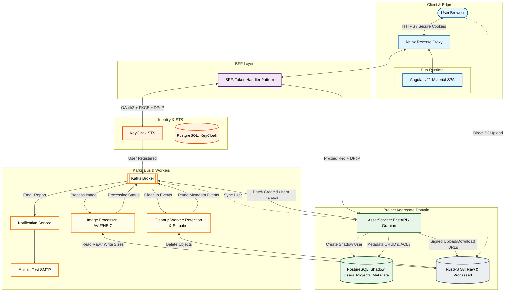

# image_platform
```text
/image-platform
├── docker/                  # Dockerfiles for all services (Python 3.14.2 base)
├── init-db/                 # SQL scripts for AssetService schema
├── persistent_data/         # .gitignore (Postgres, Kafka, Redis, RustFS data)
├── secrets/                 # .gitignore (Certs, KeyCloak secrets, DPoP keys)
└── services/
    ├── shared-core/         # Shared Pydantic models (Message schemas, Error types)
    │   ├── src/
    │   └── tests/           # Pytest suite
    ├── frontend/            # Angular v21 + Bun + Nginx
    ├── bff-token-handler/   # FastAPI Security Proxy + Redis Client
    │   ├── src/
    │   └── tests/           # Pytest suite
    ├── asset-service/       # Business Logic + Pytest suite
    │   ├── src/
    │   └── tests/           # Pytest suite
    ├── image-processor/     # CPU-intensive Worker + Pytest
    │   ├── src/
    │   └── tests/           # Pytest suite
    └── email-notification/  # Notification Worker + Pytest
        ├── src/
        └── tests/           # Pytest suite
```

Image storage and processing project.
