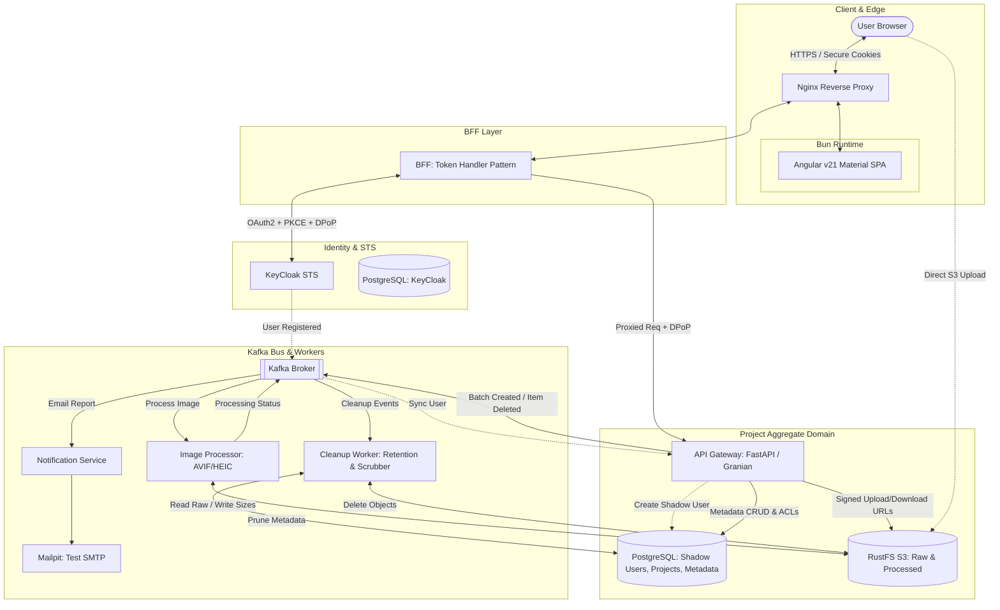

This is a sophisticated, high-security architecture. By combining the **Token Handler Pattern (BFF)** with **DPoP** (), you are creating a "Sender-Constrained" security model where even a stolen token is useless without the specific private key held by the BFF.

The **Project as an Aggregate** ensures that the API Gateway maintains strict consistency between image metadata, target resolutions (, etc.), and the underlying  storage keys in RustFS.

---

### System Architecture Diagram

This diagram illustrates the flow from the Angular/Bun frontend through the secure perimeter to the event-driven processing pipeline.



---

### Detailed Project Structure

Each service is a self-contained `uv` project with independent environments and `pyproject.toml` files.

#### 1. Root Orchestration

```text
/platform-root
├── docker-compose.yaml             # Orchestrates the full stack
├── .python-version                 # Set to 3.14.2
├── .env                            # Global config (Kafka seeds, DB credentials)
├── infra/                          # Infrastructure configs
│   ├── nginx/default.conf          # Reverse proxy routing
│   ├── postgres/init/              # SQL scripts for KC and APP databases
│   └── keycloak/                   # Realm and Client exports

```

#### 2. Frontend (Angular + Bun)

```text
/frontend
├── src/                            # Angular v21 Material source
├── package.json                    # Managed by Bun
├── bun.lockb                       # Bun lockfile
└── angular.json

```

#### 3. BFF Service (The Token Handler)

**Responsibility:** Secure session management, Cookie-to-Token exchange, DPoP proof generation.

```text
/services/bff-token-handler
├── pyproject.toml                  # uv project (FastAPI, Granian, httpx)
├── src/
│   └── bff/
│       ├── entrypoints/            # FastAPI routes
│       ├── security/               # OIDC, PKCE logic, DPoP Signer
│       ├── session/                # Encrypted HTTP-only cookie logic
│       └── config.py               # Pydantic Settings v2
└── tests/                          # Pytest (Auth flow simulation)

```

#### 4. API Gateway (The Aggregate Root)

**Responsibility:** Project/Image CRUD, ACL management, Shadow User sync, S3 URL signing.

```text
/services/api-gateway
├── pyproject.toml                  # uv project (FastAPI, Granian, SQLAlchemy/SQLModel)
├── src/
│   └── gateway/
│       ├── domain/                 # Project Aggregate (Project, Batch, Image entities)
│       ├── api/                    # Image CRUD & Read Access (ACL) endpoints
│       ├── repositories/           # Postgres adapters (Shadow Users, Project Metadata)
│       ├── services/               # RustFS S3 Presigner & Kafka producers
│       └── config.py               # Pydantic Settings v2
└── tests/
    └── pytest/                     # Unit tests for Aggregate logic & ACLs

```

#### 5. Image Processor (The Worker)

**Responsibility:** Batch processing, resolution scaling (, , ), AVIF conversion.

```text
/services/image-processor
├── pyproject.toml                  # uv project (Pillow, pillow-heif, aiokafka)
├── src/
│   └── processor/
│       ├── engine/                 # Image scaling & conversion logic
│       ├── kafka/                  # Consumer for 'batch.created' topic
│       └── config.py
└── tests/
    └── pytest/                     # Image quality and resolution tests

```

#### 6. Notification Service

**Responsibility:** Aggregating processing results into a final report.

```text
/services/notification-service
├── pyproject.toml                  # uv project (aiokafka, aiosmtplib)
├── src/
│   └── notifications/
│       ├── reports/                # Logic to format success/failure email
│       ├── mailer/                 # Mailpit SMTP integration
│       └── config.py
└── tests/
    └── pytest/                     # Email template rendering tests

```

#### 7. Shared Library

```text
/libs/shared-core
├── pyproject.toml                  # Shared uv lib
└── src/shared_core/
    ├── models/                     # Shared Pydantic schemas (uuid7 logic)
    └── events/                     # Kafka event schemas (Registration, Batch)

```

### 8. Cleanup Worker (The Scrubber)

```text
/services/cleanup-worker
├── pyproject.toml                  # uv project (aiokafka, aiobotocore, sqlmodel)
├── src/
│   └── cleanup/
│       ├── handlers/               # Logic for 'project.deleted' or 'file.expired'
│       ├── scheduler/              # Cron logic for orphan scrubbing (S3 vs DB)
│       ├── storage/                # RustFS/S3 deletion client
│       └── config.py
└── tests/
    └── pytest/                     # Integration tests for recursive deletion
```
---

### Key Component Explanations

#### The Project Aggregate Root

The `api-gateway` treats the **Project** as the boundary.

* **Shadow Users:** When KeyCloak fires a `user_registered` event to Kafka, the Gateway creates a record in its own Postgres. All projects are linked to this local  user.
* **Physical vs. Metadata:** RustFS stores files as `{image_uuid7}.avif`. The Gateway's database maps this to the user's "Display Name". Renaming an image only updates the database metadata, ensuring  renaming performance without moving S3 objects.
* **CRUD & Access:** The Gateway provides endpoints for creating projects, adding batches, and a `ProjectAccess` table to manage read-only permissions for other shadow users.

#### High-Security Auth ( + )

* **Authorization Code + PKCE:** Performed by the BFF to prevent code interception.
* **DPoP:** The BFF includes a  header in every request to the API Gateway. This header contains a JWT signed by the BFF, proving that the bearer of the token is the legitimate  client.

#### Processing & Resolutions

The `image-processor` consumes the batch task and produces three specific outputs:

1. **Normal:** Full size AVIF.
2. **Preview:** Downscaled to  (if original is larger).
3. **Thumbnail:** Small, high-compression variant.
Each is uploaded to a resolution-specific path in the `processed` bucket.

#### Storage Hygiene & Deletion Flow
The API Gateway no longer performs heavy I/O deletions. Instead:

Soft Delete: When a user deletes a project, the Gateway marks the record as deleted in PostgreSQL.

Event Trigger: The Gateway emits a PROJECT_PURGE_REQUESTED event to Kafka.

Async Cleanup: The Cleanup Worker picks up the event, identifies all associated blob keys (Raw, Normal, Preview, Thumbnail), and executes a batch delete against RustFS.

Verification: Once storage is cleared, it performs the final hard-delete or archive update in the database.

#### The "Orphan" Scrubber
Because users might upload files to S3 via presigned URLs but never finish the "Confirm Upload" step in the API, the Cleanup Worker runs a daily task:

It lists objects in the uploads/tmp/ prefix of RustFS.

Any file older than 24 hours without a corresponding "Ready" flag in DB_APP is automatically purged.

**Would you like me to generate the `pyproject.toml` and Pydantic Settings models for the API Gateway and BFF services next?**
